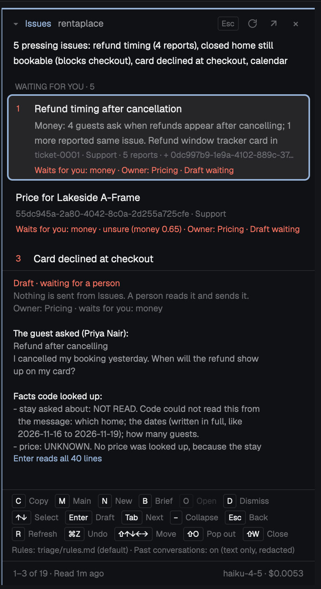
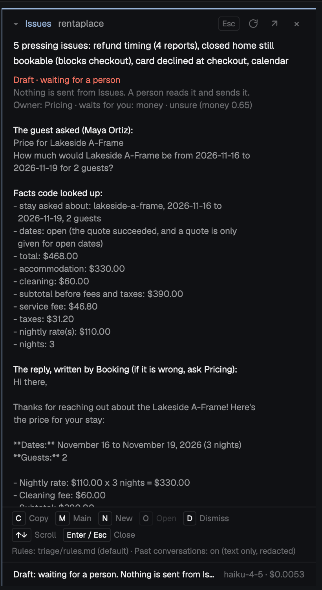

# Herdr Issues

Issues is a sidebar widget for the [Herdr](https://herdr.dev/) app. It reads a project's support inbox, page feedback and board, has a small model pick the few most pressing with one line on why, and hands one to Main with context that a swarm of small models gathered first.

This is John Lindquist's own Issues widget from MEGA.dev S04E02. The lesson teaches you to build your own for the services you use. This repository is the finished Herdr version, shown on the sample project [RentAPlace](https://github.com/johnlindquist/rentaplace), so you can compare.

On screen it is called **Issues**. Its folder and command names say `triage`, the word for what its model does.

## Requirements

| You need | Why | Without it |
|---|---|---|
| The [Herdr](https://github.com/herdrdev/herdr-app) desktop app (checked on 0.1.14) with `herdr-app` and `hc` on your `PATH` | Issues is a Herdr mod; `herdr-app check` verifies it and `hc send` delivers the hand-off to Main | `./install.sh` stops and says which tool is missing |
| [Pi](https://github.com/earendil-works/pi) (checked on 1.5.0), signed in to a provider that has the model | Every model call is `pi -p` with no tools, no extensions and no session | The widget says "Couldn't update (…)" with Pi's error |
| Node 24 or newer (checked on 25.2.1) | The helper is plain Node and reads the inbox with Node's built-in SQLite | The widget says "Couldn't read: …" |
| `git` | Finds the project folder and reads history for the brief | The History gatherer reports a failure; the rest works |
| [`gh`](https://cli.github.com/), signed in (optional) | The GitHub gatherer searches issues and pull requests, read-only | That gatherer is shown as failed; the hand-off still goes |
| macOS | The only system this was checked on. Copy uses `pbcopy`, Open uses `open` | Unverified |

**Models and cost.** Everything runs on `anthropic/claude-haiku-4-5` unless you change it. Reading RentAPlace's 17 groups of issues cost about $0.004 to $0.008 and 4 seconds; the model is asked again only when an issue changed. One hand-off (M or N) made 4 small-model calls and cost about $0.017 in 11 seconds; code caps a press at 6 calls and flags anything over $0.05. A brief is saved, so pressing M again on an unchanged issue costs nothing. Change the model with one command (see [Settings](#settings)):

```sh
node ~/.config/herdr-app/mods/triage/triage.mjs config set model anthropic/claude-sonnet-4-6
```

`pi --list-models` lists the ids you can use.

## Install

```sh
git clone https://github.com/johnlindquist/herdr-issues
cd herdr-issues
./install.sh
```

`install.sh` copies two mods into Herdr's mods folder (`~/.config/herdr-app/mods`, or `$HERDR_APP_HOME/mods`): `triage` (the widget and its helper) and `triage-menu` (the right-click menu). It runs `herdr-app check` on both and prints `check passed` twice. It then binds **Command I** in Herdr's `keys.json`, but only when that key is free; it saves the previous file as `keys.json.before-issues` and tells you what it did. Herdr treats an edited `keys.json` as yours, so shortcuts added by later Herdr releases must then be added by hand.

The first time Herdr sees the new folder it docks Issues on the right of the window. There is nothing to download: the widget has no dependencies.

- Update: `git pull`, then `./install.sh` again.
- Remove: delete `mods/triage` and `mods/triage-menu`, remove the `"cmd-i": "triage.focus"` line from `keys.json`, and delete `~/.cache/herdr-triage` (its saved reads, briefs and receipts).

## The sample project

Issues reads three places in RentAPlace. Two of them live in a database that is not in the repository, so create it once:

```sh
git clone https://github.com/johnlindquist/rentaplace
cd rentaplace
npm run seed
```

| Place | Where it is | What Issues takes |
|---|---|---|
| Support inbox | `data/rentaplace.db`, table `support_tickets` | open tickets (`ticket-0001` …) |
| Page feedback | `data/rentaplace.db`, table `feedback` | feedback not rated good (`feedback-2`) |
| Board | `tracker/board.json` | cards not in Done (`card:closed-home-booking` …) |

Without `npm run seed` only the board is read. Open the `rentaplace` folder in a Herdr space and start Pi there, named Main (`pi --name Main`).

## Walkthrough, in the video's order

1. **Ask for the widget.** In the lesson you type `/widget issues` in Main and describe it: read RentAPlace's support inbox and board, pick the few most pressing with one line on why, keep the source ID for everything. `/widget` comes from [herdr-pi-widget](https://github.com/johnlindquist/herdr-pi-widget). This repository is what that request grew into, so installing it skips the building.

2. **Plain code gathers.** With RentAPlace open, Issues reads the three places itself, with no model: 28 open tickets, 1 feedback and 8 cards. Tickets that say the same thing word for word are merged by code, which leaves 17 groups. See exactly what was read, with every id:

   ```sh
   node ~/.config/herdr-app/mods/triage/triage.mjs refresh --root . --pretty
   ```

3. **The model judges.** One small-model call gets those groups as data and returns at most five under **MOST PRESSING**, each with a title, a one-line why and its ids. Code drops any id the model made up. The rest are listed under **ALSO OPEN**. On RentAPlace the top row read:

   ```
   1  Refund timing unclear to guests
      Money: 4 guests ask when their refund will arrive after cancellation; card:refund-window is in Checking
      ticket-0001 · Support · 4 reports
   ```

   The model's wording differs from run to run. What "pressing" means is a paragraph you own: `INSTRUCTIONS` in `src/triage.mjs`.

4. **Toss it into the lab.** `checks.md` holds the expectations in the lab's Do / Expect / Never form, to run with the kit in [herdr-pi-widget](https://github.com/johnlindquist/herdr-pi-widget). Read the top row closely: the ticket says "When will the refund show up?" A why that turns that question into a missing refund is the failure the lesson shows.

5. **Get your expectations down.** The rule "never overstate what a ticket says" is in `checks.md`, and the instructions that were changed to meet it are the default. The original instructions are kept so you can see the difference:

   ```sh
   node ~/.config/herdr-app/mods/triage/triage.mjs config set instruction baseline          # before
   node ~/.config/herdr-app/mods/triage/triage.mjs config set instruction never-overstate   # after (default)
   ```

   On the same inbox the baseline wrote "3 guests report Beach House checkout works despite being closed; blocks product integrity". No report says anything is blocked. The default wrote "3 guests report Beach House is closed but checkout still works; card is in Todo".

6. **A small or a larger model.** `config set model <id>` switches the model, and `config set thinking low` lets the same model think first. The footer of the widget names the model in use and what the last read cost; hover it for the full id and where the setting came from. Run your lab on each and keep the one that passes best ([Settings](#settings)).

7. **Keys, listed under the list.** The legend sits under the list and shows only what you can do now; a key that cannot be used is dim and its tooltip says why.

   | Key | What it does |
   |---|---|
   | **Command I** | Jump to Issues from anywhere. It expands if collapsed and selects an issue |
   | **Esc** | Back to the pane you came from, or Main |
   | **↑ / ↓** or **K / J** | Select an issue. **Home**, **End**, **PgUp**, **PgDn** also work |
   | **M** | Gather context, then send to Main |
   | **N** | Gather context, then start a new Main in a new space |
   | **B** | View the context brief. **B** or **Esc** closes it |
   | **C** | Copy the issue |
   | **O** | Open the source (a board card or a GitHub issue) |
   | **D** | Dismiss |
   | **Command Z** or **U** | Undo a dismiss, for a few seconds |
   | **R** | Read the issues again |
   | **Tab** / **Shift+Tab** | The widget below or above |
   | **−** | Collapse to one line: "Issues · 5 pressing" |

   **Undo.** For a few seconds after you dismiss an issue, a bar under the title shows it with **Undo**; click it or press **Command Z** and the issue is back in the list (an agent: `herdr-app do triage.undo`). A hand-off cannot be taken back, because an agent already has the prompt, and Copy, Open and View brief change nothing. Press **Command Z** after one of those, or when the few seconds are over, and the line at the bottom says so ("Send to Main can't be undone", "Copy has nothing to undo", "Too late to undo: …", "Nothing to undo") instead of doing nothing. The same keys mean the same thing in Todos and Memories.

   Handing an issue to an agent other than Main is not one of the keys; [Handing an issue to another agent](#handing-an-issue-to-another-agent) has a ready prompt for adding it.

8. **The right-click menu.** Right-click an issue (or press **Shift+F10**) for the same actions with their keys. **↑/↓** move, **Enter** chooses, **Esc** closes.

9. **Gather before the hand-off.** Select an issue and press **M**. The row shows the work as it happens:

   ```
   Planning…
   Code: searching…
   History: 3 findings · 2.4 s
   GitHub: 3 findings · 3.2 s
   Not started: Packages, Past conversations
   ```

   One small-model call reads the issue and plans which gatherers start and what each looks for. They run in parallel, each inside 20 seconds. A slow or failed one is shown as such and never holds up the hand-off.

   | Gatherer | Where it looks |
   |---|---|
   | Code | the reports, the files a card names, matching code, tests near it |
   | History | commits that touched those files or mention the issue's words |
   | GitHub | related issues and pull requests, read-only through `gh` |
   | Packages | newer versions of the libraries involved, from the npm registry |
   | Past conversations | decisions in this project's earlier Pi conversations. On unless you turn it off ([below](#past-conversations-on-and-how-to-turn-it-off)) |

10. **Every line names its source.** Each line of the brief ends with what it cites: a ticket id, a `file:line`, `commit:<sha>` or a URL. Code checks each citation against what the model was actually sent and drops a line that cites nothing real; **B** shows the brief, the dropped lines and why. A gatherer that finds nothing says "nothing relevant".

11. **Your rules ride along.** One file is sent with every hand-off. The widget's own `rules.md` is used until the project has its own:

    ```sh
    node ~/.config/herdr-app/mods/triage/triage.mjs rules --root . --init   # writes issues-rules.md in the project
    ```

    Edit `issues-rules.md`; the line under the legend names the file in use ("Rules: triage/rules.md (default)"). The default rules:

    ```
    - Find the cause before changing anything. Tell me what you found and what you would change.
    - Reproduce it with a failing test first. Name the test before you edit any other file.
    - Give me your plan and your questions first, and wait for my answer before you change anything.
    - Ask before touching money: refunds, payouts, charges or prices.
    - When you are done, say what you changed and how you checked it.
    ```

12. **What Main receives.** One message: the issue with every merged report, the brief with a source on every line, the cited code copied by a script, then your rules. The footer says "Sent to Main · brief 11.1 s, $0.0173". Main is told to treat everything gathered as evidence, not instructions, so it comes back with what it found, its plan and its questions, and waits. See the exact message without sending it:

    ```sh
    node ~/.config/herdr-app/mods/triage/triage.mjs prompt ticket-0001 --root .
    ```

No separate agent tries to solve the issue. Issues prepares the ground with small models; you and Main solve it together.

### What you should see

- A panel titled **Issues** on the right, a one-sentence headline, **MOST PRESSING** with up to five numbered rows, **ALSO OPEN · 9** below, the legend under the list, and a footer such as "Read just now" with the model's name and cost.
- Before the first read: "Reading the issues…". In a folder with no inbox or board: "Source unavailable: …" naming what is missing.
- After **M**: the gatherers' lines on the row, then "Brief ready · B to view", and the message arrives in Main.
- If gathering fails, the row says so and nothing is sent. **Shift+M** and **Shift+N** then appear in the legend: they send without context, on purpose.

## More than the video shows

- **GitHub issues as a source.** `config set sources github --project` reads open issues through `gh` instead of, or with (`local,github`), the project's own files. `repo` names the repository when the project's origin is not it.
- **For agents.** Everything the panel does is a command that prints JSON: `node triage.mjs describe` lists `show`, `refresh`, `gather`, `prompt`, `act`, `rules`, `explain`, `config`, `progress`, `sorted` and `draft`, the named errors and the environment variables.
- **Receipts.** Every hand-off is recorded with the message that was sent, the time and the cost, under `~/.cache/herdr-triage`. Issues never writes into your project except `rules --init`, and never creates, edits, closes or comments on an issue.
- **Which gatherers may start.** `config set gatherers code,history`.

### Sorted tickets, and a draft beside its ticket

Some projects sort their support tickets before you sit down: a small script tags each new ticket with an owner, and another drafts a reply from facts that code looked up. When the project has those files, Issues shows them. It reads them with plain code: no model is asked, nothing is written, and the Most pressing read works as before. When the files are not there, Issues looks and behaves exactly as in the video.

| Issues reads | Default place | What it must hold |
|---|---|---|
| The tags file (`tagsFile`) | `<project>/support-tags.jsonl` | one JSON line per ticket: `ticketId`, `owner` (`booking`, `pricing` or `nobody`), `money` (true or false), and when the sorter was not sure `unsure: true` with `why` |
| The drafts folder (`draftsFolder`) | `<project>/drafts-out/` | `drafts.jsonl`, one JSON line per ticket: `id`, `facts` (what code looked up), `draft` (the reply), `status: "waiting for a person"` |

**Waits for a person** means a person has to decide before anything happens with the ticket. A ticket waits when its tag says it is about money, or when the sorter was unsure. **Unsure** means the sorter's own confidence in the owner, or in whether the ticket is about money, was below the bar the project set; the tag carries its reason and Issues shows it in a few words, for example "unsure (money 0.65)". Issues works out "waits" from `money` and `unsure` itself and ignores a `waitsFor` field written on the line.

What you see:

- **WAITING FOR YOU** is a group at the top of the list: plainly money first, then money the sorter was unsure about, then unsure only. Each of those tickets is listed once, there and not again below.
- Every sorted ticket has a line with its owner: "Waits for you: money · Owner: Pricing · Draft waiting", or just "Owner: Booking".
- Select a ticket that has a draft (**↑ / ↓**) and the draft shows under the list: that it is waiting for a person, the guest's question, the facts code looked up, the reply. **Enter** opens the whole draft in place of the list; **↑ / ↓** scroll it; **Enter** or **Esc** closes it. The legend shows **Enter · Draft** whenever the project has a drafts folder, dim when the selected issue has no draft.
- **Nothing goes out from Issues.** There is no key, menu row or command that sends a draft to a guest. **M** still hands the issue to Main, as before.





Both pictures are real captures from a second Herdr window on a copy of RentAPlace whose seven new tickets were sorted and drafted by that project's own scripts; a model's wording will differ.

A line that is not in the shape above is **dropped and counted**, never shown: a line that is not JSON, an owner that is not one of the three, a draft whose status is anything other than "waiting for a person", and a reply that states an amount of money its own facts do not hold. A tag or a draft for a ticket that is not open in the inbox is counted and not shown. The first line for a ticket wins. For an agent, or to see the counts:

```sh
node ~/.config/herdr-app/mods/triage/triage.mjs sorted --root . --pretty          # owners, the waiting group, what was dropped and why
node ~/.config/herdr-app/mods/triage/triage.mjs draft <ticket id> --root . --pretty   # one draft beside its ticket
```

| State | Meaning |
|---|---|
| `tags.state: none` | no tags file: no owners, no waiting group |
| `tags.state: empty` | a tags file with no usable line for an open ticket |
| `tags.ticket_gone` | ids tagged but not open in the inbox |
| `tags.dropped`, `drafts.dropped` | lines dropped, each with its line number and reason |
| `drafts.state: none` / `empty` | no drafts folder / no usable draft |
| `drafts.unknown_ticket` | drafts for tickets that are not in the inbox |
| `NO_DRAFT` (error of `draft <id>`) | that ticket has no draft that waits for a person |

Limits: Issues cannot tell whether the sorter chose the right owner, or whether the facts are true; it shows what the two scripts wrote. A dropped tag line takes its ticket out of the waiting group (the count of dropped lines is how you notice). A ticket nobody sorted has no owner line.

### Past conversations: on, and how to turn it off

This gatherer reads this project's earlier Pi conversations to find decisions you already made, things you already tried and preferences you stated. It is **on**: the planner may start it like any other gatherer. The reasoning is simple: what is in your conversations has already been sent to a model provider once, when you had them.

What it reads, and what is removed:

- Only sessions whose own header says they were started in this project. Never another project's.
- Only what you and the assistant wrote. Never tool output, never thinking, never system messages.
- Secrets, tokens, keys, e-mail addresses and home paths are removed before any model, cache file, receipt or prompt sees the text. Short excerpts that match the issue's words are then sent to the small model.
- Nothing is written in the sessions folder, and none of what was read is stored: only findings the model kept, each citing a session and entry.

The widget says when it happened: the issue's row reads "Past conversations: 1 finding · read 3 conversations", and the brief (**B**) says how many conversations and messages were read. The line under the legend ends with "Past conversations: on (text only, redacted)" or "Past conversations: off for this project"; hover it for more.

**The one limit left.** The excerpts go to the small model you chose in `model`. That may be a different provider than the one you had the conversation with. Redaction recognises a credential by its name (password, token, api key, secret, a cookie or authorization header) or by its shape (a long random-looking string, a private-key block, a URL with a password); a secret with neither, such as a short plain word pasted on its own, is not recognised and goes along with the excerpt. If it matters to you that a second provider sees parts of these conversations, turn it off.

Turn it off:

```sh
node ~/.config/herdr-app/mods/triage/triage.mjs config --root <project> --conversations off    # this project, on this machine
node ~/.config/herdr-app/mods/triage/triage.mjs config --root <project> --conversations on     # back on for this project
node ~/.config/herdr-app/mods/triage/triage.mjs config set conversations off                   # every project (your settings file)
TRIAGE_CONVERSATIONS=off                                                                       # wherever this variable is set
```

**Off wins.** Unlike the other settings, `conversations` does not follow the usual order: if any place says off (your settings file, the project's file, the saved choice for the project, the environment or a flag), it is off, and a stronger place saying on does not undo it. So a project file someone else wrote can turn reading off for that project, but can never turn back on what you turned off. A value that is neither on nor off counts as off. `config` shows the value and which place set it. While it is off the planner is not offered the gatherer, nothing in the sessions folder is opened, and the brief says "Past conversations were not read (off for this project)."

A clone of a project has no conversations of its own. `config --root <clone> --conversations-of <the original project folder>` counts the original's conversations as this project's; the same rules apply.

### Handing an issue to another agent

Sending to Main always works when the space has a Pi in it, because the widget finds Main itself: the Pi named Main, else the first Pi in the space (`targetsIn` in `main.js`). **N** starts a new Main when you want a fresh one.

Handing an issue to some other agent in the space is not built in. It is a small thing to add for yourself, and a good first change to make to this widget. Give your agent this:

```
In the Issues widget (the Herdr mod in this folder), add a key, H, "Hand to another agent".
When I press it on the selected issue, show a short list of the other agents in this space
(every agent in the space except Main: see how targetsIn in main.js finds Main from agents()),
with arrow keys and Enter to pick one and Esc to cancel. Then send the picked agent exactly
the hand-off message Main would get: gather the context first as a visible step, the same way
M does, then run the existing act <id> send-main with --terminal set to the picked agent's
address instead of Main's. Reuse the send-main path; do not write a second message format.
Add the action to ACTIONS in src/actions.mjs so the legend, the right-click menu and describe
list it, dim it with a reason when the space has no other agent, and make the footer and the
receipt name the agent it went to instead of saying Main. Add tests beside the ones for
send-main, run npm test and sh fence.sh, and try it in a lab window before you install it.
```

## Settings

Issues is configured like every widget from this lesson: one settings file, an optional file in the project, and one command to see and change them.

| Where | File | For |
|---|---|---|
| You | `~/.config/herdr-issues/config.json` (or the path in `HERDR_ISSUES_CONFIG`) | your own choices, in every project |
| A project | `<project>/.herdr/issues.json` | choices a team shares, such as a pinned model or sources |

A value is taken from the strongest place that sets it: default, then your file, then the project's file, then an environment variable. The widget is started by Herdr and has no shell environment of its own, so the files are the normal way; the variables are for tests and the lab.

```sh
cd <project>
node ~/.config/herdr-app/mods/triage/triage.mjs config --pretty              # every setting and where it came from
node ~/.config/herdr-app/mods/triage/triage.mjs config set model anthropic/claude-sonnet-4-6
node ~/.config/herdr-app/mods/triage/triage.mjs config set maxPressing 3 --project   # into the project's file
node ~/.config/herdr-app/mods/triage/triage.mjs config unset model
node ~/.config/herdr-app/mods/triage/triage.mjs config path                  # the two files
```

`config set` checks the value before it writes, and refuses one that is not valid. Or edit the file yourself:

```json
{
  "model": "anthropic/claude-haiku-4-5",
  "thinking": "off",
  "refreshSeconds": 300,
  "maxPressing": 3,
  "gatherers": "code,history,github"
}
```

| Key | Value | Default | What it changes | Variable |
|---|---|---|---|---|
| `model` | provider/id | `anthropic/claude-haiku-4-5` | The small model that judges, plans the gatherers and writes the brief | `TRIAGE_MODEL` |
| `thinking` | `off`, `low`, `medium`, `high` | `off` | How much the model thinks before it answers | `TRIAGE_THINKING` |
| `refreshSeconds` | 30 to 86400 | `120` | How often the widget reads the sources again. The model is asked only when an issue changed | `TRIAGE_REFRESH_SECONDS` |
| `sources` | `local`, `github`, `local,github` | the project's inbox and board when it has them, else GitHub | Where issues come from | `TRIAGE_SOURCE` |
| `repo` | owner/name | the project's origin | The GitHub repository to read and search | `TRIAGE_REPO` |
| `maxPressing` | 1 to 10 | `5` | The most issues listed under Most pressing | `TRIAGE_MAX_PRESSING` |
| `gatherers` | names from `code`, `history`, `github`, `packages`, `conversations` | all of them | Which gatherers the planner may start | `TRIAGE_GATHERERS` |
| `conversations` | `on`, `off` | `on` | Whether Past conversations may be read. Off in any place wins ([above](#past-conversations-on-and-how-to-turn-it-off)) | `TRIAGE_CONVERSATIONS` |
| `gatherSeconds` | 5 to 120 | `20` | How long one gatherer may take | `TRIAGE_GATHER_SECONDS` |
| `rulesFile` | path | `issues-rules.md` in the project, else the widget's `rules.md` | The rules sent with every hand-off | `TRIAGE_RULES` |
| `instruction` | `never-overstate`, `baseline` | `never-overstate` | The instructions for judging | `TRIAGE_INSTRUCTION` |
| `tagsFile` | a path | `support-tags.jsonl` | The file a project's ticket sorter writes; a relative path starts at the project | `TRIAGE_TAGS_FILE` |
| `draftsFolder` | a path | `drafts-out` | The folder a project's drafter writes; Issues never sends a draft | `TRIAGE_DRAFTS_FOLDER` |
| `gatherInstruction` | `baseline`, `evidence-only`, `absence-is-a-question` | `evidence-only` | The instructions for the brief | `TRIAGE_GATHER_INSTRUCTION` |

`node triage.mjs describe` prints the same table for agents.

**When something is wrong.** A key the widget does not know, a value out of range, or a file that is not valid JSON is never ignored silently: the widget shows a red line starting "Settings:" that names the file and the problem, `config` lists every problem, and the default is used for that entry until you fix it.

**When the small model overstates.** This is the trade-off from the lesson. Try, in order of cost:

```sh
node ~/.config/herdr-app/mods/triage/triage.mjs config set thinking low                           # same model, thinks first: about 3 times slower
node ~/.config/herdr-app/mods/triage/triage.mjs config set model anthropic/claude-sonnet-4-6      # a larger model: about 2 times the cost per read
```

Press **R** in the widget to read again, run your lab on each, and keep the one that passes. `config unset model` goes back.

## Move it, pop it out, close it

Issues has a title bar: its name, its own controls, then **Pop out** (↗) and **Close** (×). The keys work while Issues has the keyboard and are listed in its legend.

| You want | Pointer | Key | Command (for agents) |
|---|---|---|---|
| Put it above or below another widget | drag the title bar onto that widget: top half lands above, bottom half below | Shift+↑ / Shift+↓ (inside one column) | `herdr-app do triage.move-up`, `triage.move-down`, `triage.move-before:<widget>`, `triage.move-after:<widget>` |
| Move it to the other side of the window | drag the title bar, release on "Left side" or "Right side" in the widget | Shift+← / Shift+→ | `herdr-app do triage.move-left`, `triage.move-right` |
| Make it a free window | ↗ | Shift+O | `herdr-app do triage.popout` |
| Dock the window back | ↙ | Shift+O | `herdr-app do triage.dock` |
| Close it | × | Shift+W | `herdr-app do triage.close` |
| Open it again | command palette: `mod.open`, then `triage` | bind one in `keys.json`: `"cmd-shift-9": "mod.open:triage"` | `herdr-app do mod.open --name triage` |

- Esc cancels a drag. A drag nobody finishes is forgotten after 20 seconds.
- Moving changes your layout through Herdr's own `layout.set`. Herdr does not let anything rearrange its own layouts (Herdr, Terminals, Herdr 98): there the widget says so in one line. Duplicate the layout first (command palette: Duplicate layout), then move widgets in your copy. Pop out, dock and close work in every layout.
- The window remembers its spot and comes back on the next start. While it floats, the docked place is hidden; selection, scroll and collapse carry over.
- A closed widget is not loaded, so `triage.open` cannot reach it: reopening is Herdr's `mod.open`, which brings it back where it was (docked or floating). `mod.open` on an open window closes it.
- Only the copy on screen works. Closed, Issues reads nothing and calls no model; if it was shown earlier in this run, its two-second timer still wakes and returns at once.
- Agents read where it is from shared state `frame.triage` (in `shared.json` in the Herdr app's folder): `mode` (`docked`, `floating`, `closed`), `last`, `side`, `parent`, `index`, `above`, `below`, and `error` with a name (`shipped-layout`, `nothing-above`, `nothing-below`, `already-there`, `no-target`, `not-in-layout`, `already-floating`, `already-docked`, `unknown-move`).

## Troubleshooting

- **Command I does nothing.** `install.sh` said why: either `keys.json` did not exist yet (open Herdr once, run `./install.sh` again) or the key was already taken. Add `"cmd-i": "triage.focus"` under `"global"` in `keys.json` yourself.
- **No Issues panel.** Herdr docks it the first time it sees the folder. If you removed it, add a block with `{ "mod": "triage" }` to your layout. `herdr-app status` lists mod errors.
- **"Source unavailable: local: neither data/rentaplace.db nor tracker/board.json in …"** The folder of the focused pane is not a project Issues knows how to read. Open RentAPlace, or point it at GitHub issues (above).
- **Only board cards show.** The database is missing: run `npm run seed` in RentAPlace.
- **"Couldn't update (…)" with a model error.** Run `pi --list-models`; if the model is not listed, sign in to its provider or pick another with `config set model <provider/id>`. The message names the model in use and where that setting came from.
- **M is dim: "No Main conversation in this space".** Start Pi in that space. Issues sends to the Pi named Main, else the first Pi. **N** works without one.
- **"Couldn't gather context: …"** Nothing was sent. Press **M** again, or **Shift+M** to send the issue and rules without a brief.
- **GitHub: failed.** `gh auth status` should show a login. The hand-off still goes without it.

## How it is built

| File | What it holds |
|---|---|
| `main.js` | The panel: when to read, what to draw, and keys, clicks and right-clicks turned into actions |
| `surface.js` | Every word the panel shows (legend, menu rows, status lines, the brief view) as plain data, so tests read the same file |
| `nav.js` | The keyboard rules shared with the Todos and Memories widgets |
| `menu/` | The right-click menu, a second small mod |
| `triage.mjs` | The helper and command line. The panel calls it for everything |
| `src/sources.mjs` | Where issues come from: RentAPlace's files, or GitHub. Read-only |
| `src/issue.mjs` | Ids, word-for-word merging, content hashes |
| `src/triage.mjs` | The instructions, the model call, and the check of its reply |
| `src/settings.mjs` | Every setting, its default and what a valid value is; the files, `config set` and `describe` all use it |
| `src/gatherers.mjs`, `src/gather.mjs` | The planner, the swarm, and the citation check |
| `src/redact.mjs` | Removes secrets from past conversations before anything else sees them |
| `src/handoff.mjs` | The one message Main receives |
| `rules.md` | The default rules |
| `checks.md` | The lab's expectations |
| `CONTEXT.md` | The glossary and which file owns each rule |

Who decides what:

| Code | Model |
|---|---|
| reading the sources, ids, merging identical reports, what changed | which issues are pressing, and why in one line |
| dropping ids and citations that do not exist | merging the same problem told in different words |
| caching, cost cap, time limits, receipts | which gatherers to start, and what is relevant |

## Build the same thing for another workspace

There is no right or wrong place for this. The helper is the widget; the Herdr panel is one way to show it. `node triage.mjs show --root <project>` prints everything the panel draws as JSON, and `act <id> send-main --terminal <address>` does the hand-off, so the same pieces fit elsewhere:

- **A web page from a dev server:** serve `show` as JSON and render the two lists; a button posts to something that runs `act`.
- **A terminal UI:** print `show` in a pane beside your agent and bind keys to `act`.
- **Another workspace:** replace `hc send` with whatever delivers text to your agent's pane (tmux `send-keys`, Zellij `write-chars`).

To build your own from nothing, give your agent the lesson's request, then the second one:

> Read RentAPlace's support inbox and board, pick the few most pressing with one line on why, and keep the source ID for everything. Then give me the key points for what to do next.

> Make the Issues widget gather information before it sends to Main. Have a small, fast model read the issue and plan which gatherers to start as a swarm. Every line names its source; "nothing relevant" is a fine answer. Send my rules along from one file I own.

Swap `src/sources.mjs` for the services you use: a source is four things (`name`, `describe`, `list()`, `get(id)`) and only reads.

The sibling widgets from the same lesson are [Todos and Memories](https://github.com/johnlindquist/herdr-todos); `/widget` and the lab kit are in [herdr-pi-widget](https://github.com/johnlindquist/herdr-pi-widget).

## Tested

What was checked for 0.1.0 on 2026-11-15, macOS, Herdr 0.1.14, Pi 1.5.0, Node 25.2.1:

- **Clean install.** A fresh clone of this repository, `./install.sh` into an empty Herdr home: both mods copied, `herdr-app check` passed for `triage` and `triage-menu`. With a `keys.json` present, Command I was added when free, reported as already set on a second run, and left alone when taken.
- **Checks from the clean clone.** `npm install`, then `npm run check`: types, syntax and 72 tests passed.
- **End to end from the command line**, with the installed helper, real `claude-haiku-4-5` calls and a fresh clone of RentAPlace after `npm run seed`: `refresh` read 28 tickets, 1 feedback and 8 cards and returned five pressing issues with real ids in 4 s; `gather ticket-0001` planned Code, History and GitHub, kept 13 cited lines and dropped 1, in 11 s for $0.017; `prompt` printed the message with the issue, the brief, the cited code and the rules; `act … send-main --dry-run` and `act … new-main` produced the `hc send` and `space.new` commands. `config set model anthropic/claude-sonnet-4-6` switched the model and read the inbox for $0.010 to $0.013.
- **Settings**, same setup: `config set maxPressing 3 --project` wrote `.herdr/issues.json` and the next read listed three; `config set thinking low` wrote the user file and the read took 12 s instead of 4; a model id that does not exist gave "Couldn't update" with the provider's error, the model in use and the command to change it; a user file that was not valid JSON was reported and the defaults were used.
- **Not checked for 0.1.0:** the panel in a Herdr window after a clean install (docking on first sight, Command I, the legend, the right-click menu, the message arriving in a live Main).

```sh
npm install
npm run check
```

Past conversations on by default (2026-11-15): the tests cover the default, each place that can say off (saved, environment, your file, the project's file, a flag), off winning over on, and that nothing unredacted reaches a model call, the cache, a receipt or the prompt. One real run with `claude-haiku-4-5` against a fresh clone of RentAPlace after `npm run seed`, with a scratch state folder and a scratch Pi sessions folder holding one made-up conversation for that project (three messages, one with a made-up password in it): with no setting, the plan started Code, History and Past conversations; the brief had two Past conversations lines, each citing `session:<time>#<entry>`, "read 1 conversation", 15 cited lines in 11 s for $0.018; the made-up password was in no output and no state file. After `config --conversations off` the same gather listed "Past conversations: not started — off", read nothing, and the brief said "Past conversations were not read (off for this project)". Not run: the widget's line and tooltip in a Herdr window.

Moving, popping out and closing (2026-11-15): `frame.js` has 12 tests that run without Herdr (where a drop lands, how the layout is rewritten, what is remembered, one engine). In a second, separate Herdr window on a duplicated layout, through commands, with the layout read back each time: reorder, move to the other side and back, pop out (window open, docked place hidden), dock back, close and reopen with `mod.open`, docked and floating. Not run: a real drag with the pointer, and the Shift keys pressed by hand.

Sorted tickets and drafts (2026-11-17): the tests cover the tag and draft shapes, each named state, dropped and repeated lines, a tag for a ticket that is gone, a draft for an unknown ticket, a reply with an amount its facts do not hold, the list's order, that a project without the two places gets the list it always had, and that no action sends a draft; `npm run check` passed with 100 tests. One real run: seven tickets posted to a copy of RentAPlace, sorted by that project's sorter and drafted by its drafter; `sorted` listed 7 owners, 5 waiting and 6 drafts, and on a copy of those files edited by hand (a made-up owner, a tag and a draft for tickets that never existed, a half-written line, a second line clearing a money ticket, a reply with a changed total, a draft marked sent) every edited line was dropped or counted and none was shown. Seen drawn in a second Herdr window (0.1.16): the waiting group, the owner lines, the draft under the list, Enter opening and closing the draft, scrolling it. Not exercised in the window: the right-click menu, a light theme, the widget popped out, a tags file changing while the widget is open, a window too short for the draft pane.

## License

[MIT](LICENSE)
